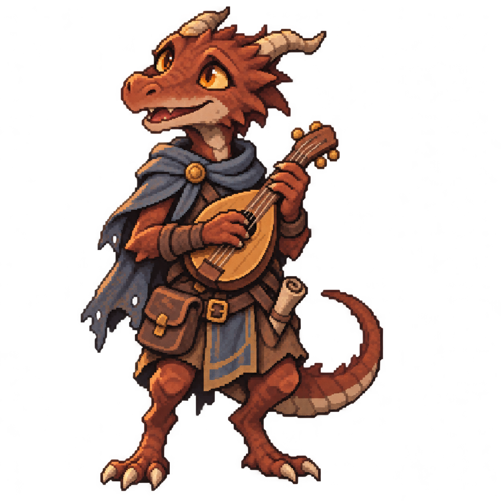

  <picture>
    <source media="(prefers-color-scheme: dark)" srcset="./assets/deekin-logo-dark-theme.svg">
    
  </picture>

  <strong>Покажите мир, который вы описываете.</strong>

Deekin помогает мастерам настольных ролевых игр превращать описание сцены в иллюстрацию. Опишите, куда попали герои и что они видят, уточните детали в черновике и покажите готовую сцену на отдельном экране игроков.

**Проект готовится к запуску.** О старте расскажем в Telegram.

<!-- Добавь реальные ссылки перед публикацией. -->
<!-- [Сайт Deekin](URL_ЛЕНДИНГА) · [Telegram](URL_КАНАЛА) -->

<h2 align="center">Почему Deekin?</h2>

  

**Дикин Скейлсингер (Deekin Scalesinger)** — кобольд-бард из Забытых Королевств, мира Dungeons & Dragons. Его можно встретить в дополнениях *Shadows of Undrentide* и *Hordes of the Underdark* к *Neverwinter Nights*. Дикин мечтал стать великим рассказчиком Фаэруна и слагал песни о подвигах своих спутников.

Мы назвали проект в его честь. Дикин превращал приключения отряда в песни, а наше приложение помогает мастеру превратить рассказ о приключении в иллюстрацию, которую увидит весь стол.